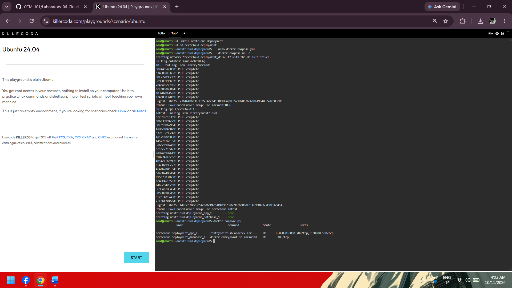
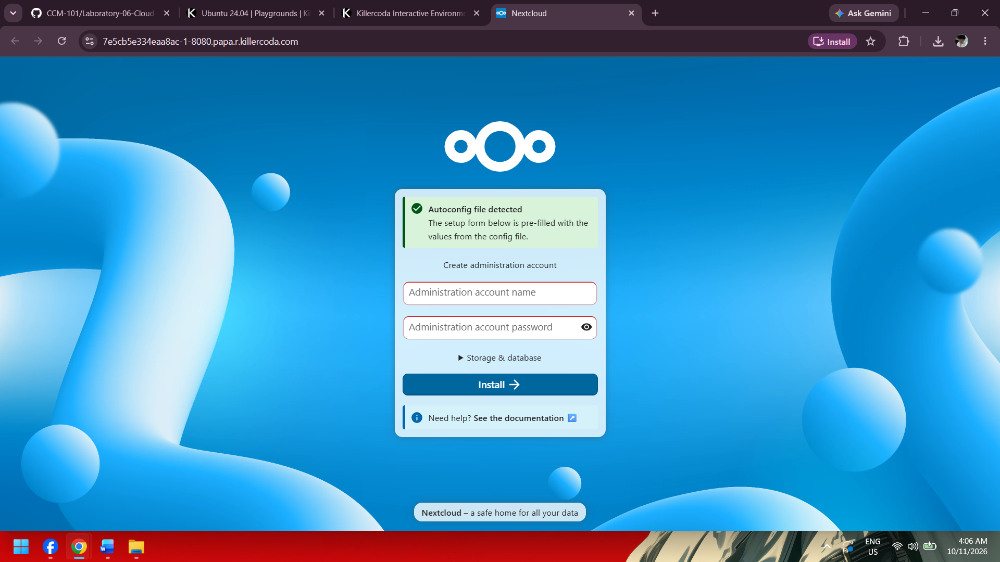
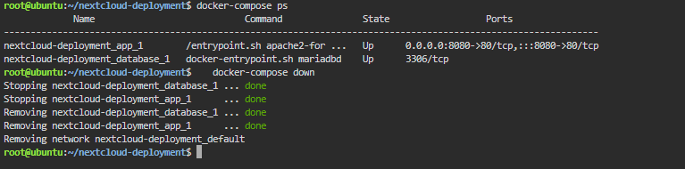

# Laboratory 06: The Cloud Deployment Engineer

## Mission Overview

In this mission, I joined the Cloud Deployment Team at CloudNova Technologies and moved from running single containers to deploying a **multi-tier application** using **Docker Compose**. I wrote a `docker-compose.yml` file that defines a Nextcloud web container and a MariaDB database container, then deployed the whole stack with one command on a KillerCoda playground. This is an example of **Infrastructure as Code (IaC)**.

## Objectives

- Explain the concept of a multi-tier application architecture.
- Understand the purpose and structure of a `docker-compose.yml` file.
- Use the nano text editor to create configuration files.
- Deploy a multi-container application (Nextcloud + MariaDB) using Docker Compose.
- Document deployment procedures and IaC principles using Markdown.
- Continue expanding my GitHub Cloud Computing Portfolio.

## Commands Executed

```bash
mkdir nextcloud-deployment
cd nextcloud-deployment
nano docker-compose.yml
docker-compose up -d
docker-compose ps
docker-compose down
```

| Command | Purpose |
|---|---|
| `mkdir nextcloud-deployment` | Created the project directory |
| `cd nextcloud-deployment` | Moved into the project directory |
| `nano docker-compose.yml` | Created the Compose file |
| `docker-compose up -d` | Deployed the stack in the background |
| `docker-compose ps` | Verified both containers were running |
| `docker-compose down` | Stopped and removed the stack |

## Screenshots

### Deployment


### Nextcloud Web Interface


### Teardown


## Skills Learned

- Designing a two-tier architecture with separate web and database containers
- Writing and editing YAML configuration files carefully with correct indentation
- Using nano to create files in the Linux terminal
- Deploying and removing multi-container applications with Docker Compose
- Using environment variables and service names to connect containers
- Accessing a containerized app through a mapped port
- Documenting infrastructure with Markdown and maintaining a GitHub portfolio

## Documentation

- [Multi-Tier Architecture](multi-tier-architecture.md)
- [Docker Compose Guide](docker-compose-guide.md)
- [Reflection](reflection.md)
